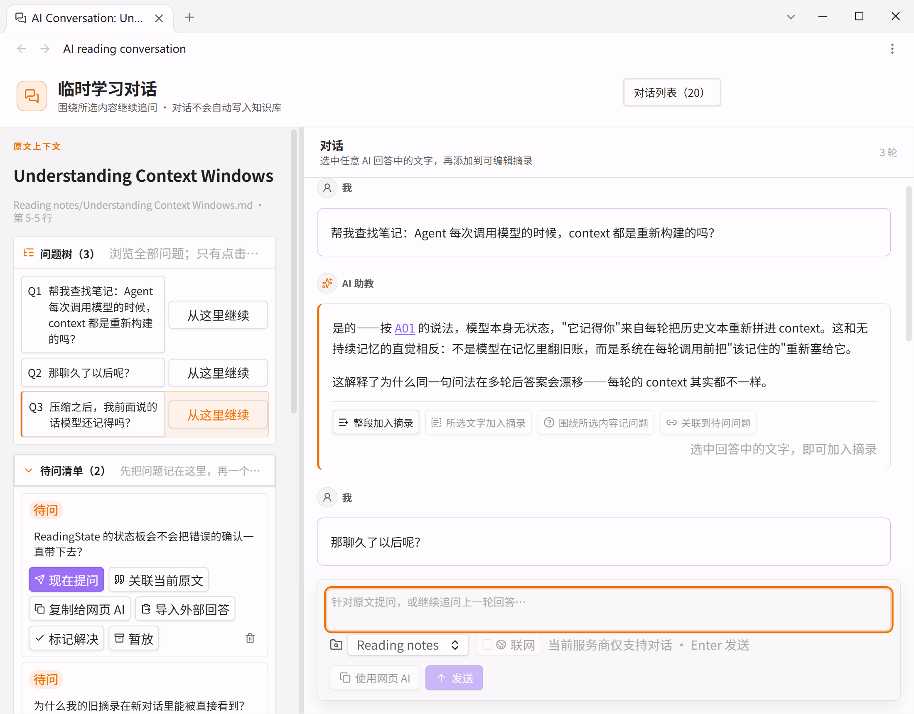
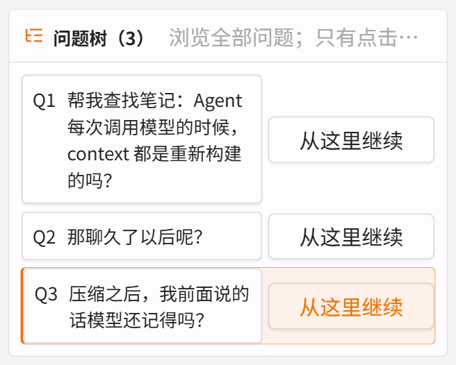
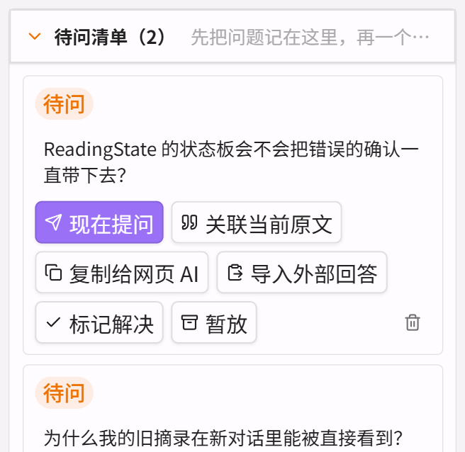
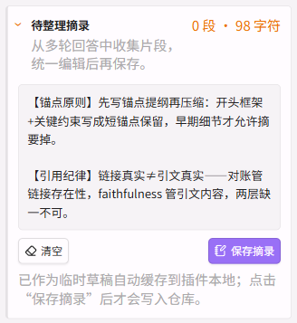

# AI Reading Companion

> **English** | [中文](#中文)

Select text in any Obsidian note, discuss it with an OpenAI-compatible model, and save only what you confirm — the conversation itself never lands in your vault automatically.



## What it does

- **Ask about any selection.** Right-click selected text or an image in a note; the answer cites your notes, not its training data.
- **Multi-turn with branches.** Follow-ups stay in the thread; the question tree lets you jump back to any earlier question and continue from there instead of re-asking.
- **Pending questions.** Park questions you haven't asked yet; ask them later without losing the thread.
- **Editable excerpt draft.** Pull text out of any answer into a draft, edit it, and save once — the draft is the only thing written to your vault, and only after you confirm.
- **Your notes, not the model's memory.** Folder-scoped lexical retrieval over the notes you allow; answer citations link to real headings, and suspect ones are flagged in the answer.
- **No hidden writes.** Conversations, reasoning, and search results stay in the view unless you save a draft or a reviewed web source.

## Why it exists

General chatbots answer from memory; this plugin answers from **your notes and your reading state**. It keeps the question tree, a pending list, and your confirmed excerpts in view, so you can trace how the conversation got to the current answer.

## Screenshots

| | |
|---|---|
|  |  |
|  | |

## Installation

Download `main.js`, `manifest.json`, and `styles.css` from the latest release into:

```text
<vault>/.obsidian/plugins/ai-reading-companion/
```

Restart Obsidian and enable **AI Reading Companion** under Community plugins.

## Setup

1. Create a named model configuration (OpenAI, Kimi, GLM, Volcengine Ark, or a custom OpenAI-compatible endpoint).
2. Choose the API protocol and enter the model ID and API key (stored in Obsidian SecretStorage).
3. Optionally enable folder-scoped local knowledge: add one allowed folder per line under **Local knowledge**.
4. Optionally configure web search (Kimi, GLM, Tavily, Brave, Exa, Serper, SearXNG, or a Remote MCP adapter).

## Privacy & data

- No telemetry, no analytics, no background network calls.
- API keys are stored in Obsidian SecretStorage and sent only to the configured endpoint.
- Conversations live in the plugin's local data (`data.json`) until you save a draft; clearing the conversation list removes them.
- Local retrieval is folder-scoped and lexical only — no embeddings, no whole-vault index.

## Development

```bash
npm install
npm run dev
npm run build
npm run lint
npm run verify
```

## Author

[antsally9-dev](https://github.com/antsally9-dev)

## License

Apache License 2.0.

---

<a id="中文"></a>

# AI Reading Companion（AI 阅读伴学）

在 Obsidian 里选中一段文字，用 OpenAI 兼容模型围绕它开聊，只有你确认的内容才会写进知识库——对话本身不会自动落盘。


## 它能做什么

- **对任意选中内容提问。** 在笔记里选中文字或图片后右键提问，答案引用的是你的笔记，不是模型的训练数据。
- **多轮对话 + 分支。** 追问留在同一条线里；问题树可以回到任意一个旧问题续接，不用重问。
- **待问清单。** 把还没问的问题先记下来，之后逐条问，不打断当前思路。
- **可编辑摘录草稿。** 从任意回答里把文字拖进草稿，编辑后一次保存——草稿是唯一会写进库的内容，且必须你确认后才写。
- **用的是你的笔记，不是模型的记忆。** 按你授权的文件夹做词法检索；答案里的引用链接到真实存在的标题，存疑的引用会在答案里标明。
- **没有隐藏写入。** 对话、推理过程、搜索结果都留在界面里，除非你保存了草稿或审阅过的网页来源。

## 为什么做这个

通用聊天机器人凭记忆回答；这个插件凭**你的笔记和你的阅读状态**回答。问题树、待问清单、你确认过的摘录都在界面上，你能看清这段对话是怎么走到当前答案的。

## 截图

| | |
|---|---|
|  |  |
|  | |

## 安装

从最新 Release 下载 `main.js`、`manifest.json`、`styles.css`，放到：

```text
<你的库>/.obsidian/plugins/ai-reading-companion/
```

重启 Obsidian，在社区插件里启用 **AI Reading Companion**。

## 配置

1. 建一个命名模型配置（OpenAI、Kimi、GLM、火山引擎，或自定义 OpenAI 兼容端点）。
2. 选 API 协议，填模型 ID 和 API key（存进 Obsidian SecretStorage）。
3. 可选：在**本地知识**里开文件夹范围的检索，一行一个授权文件夹。
4. 可选：配置联网搜索（Kimi、GLM、Tavily、Brave、Exa、Serper、SearXNG，或 Remote MCP 适配器）。

## 隐私与数据

- 没有遥测、没有分析、没有后台网络请求。
- API key 存在 Obsidian SecretStorage，只发往你配置的端点。
- 对话存在插件本地数据（`data.json`）里，直到你保存草稿；清空对话列表会一并删除。
- 本地检索只在你授权的文件夹内做词法检索——不建 embedding、不建全库索引。

## 开发

```bash
npm install
npm run dev
npm run build
npm run lint
npm run verify
```

## 作者

[antsally9-dev](https://github.com/antsally9-dev)

## 许可证

Apache License 2.0.
