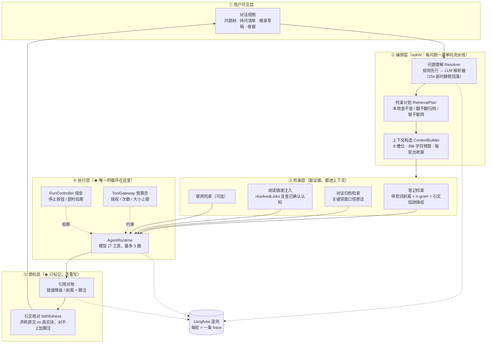
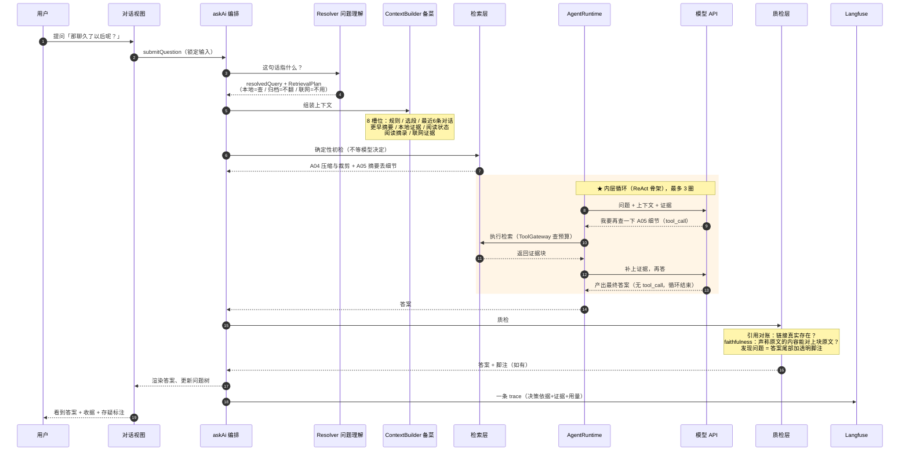
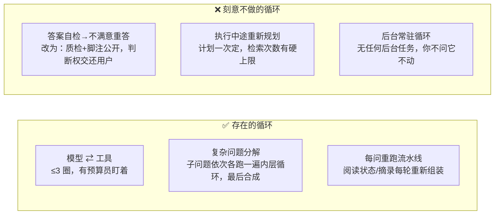

# Agent 架构图（AI Reading Companion）

两张图：第一张看**结构**（谁负责什么），第二张看**流程**（一次问答从头到尾怎么走、循环在哪）。

---

## 图 1：整体分层架构

---

## 图 2：一次问答的泳道时序（"聊久了以后呢？"）

---

## 图 3：循环的边界（哪些"环"有、哪些刻意没有）

**为什么质检不重写答案**：① 每重答一次用户多等约 20 秒；② 重写版未必更对，且用户看不到"哪版是对的"；③ 脚注把"这里有存疑"公开给用户，与产品哲学一致——**你确认的才算数**。
